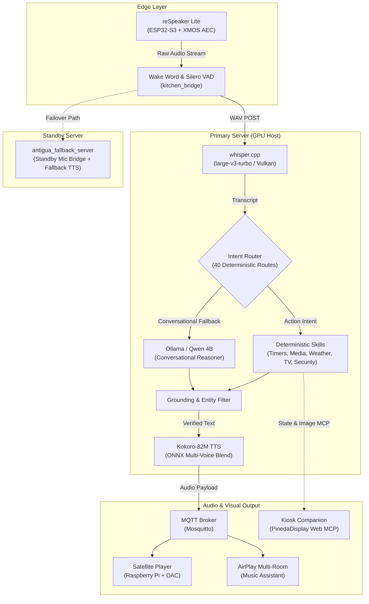

# Antigua

A local-first, privacy-respecting voice assistant architecture engineered for deterministic control, neural speech synthesis, and distributed multi-room orchestration.

[](https://github.com/flavanoids/antigua-assistant/actions/workflows/ci.yml)
[](LICENSE)
[](pyproject.toml)
[](https://ollama.ai)
[](https://github.com/ggerganov/whisper.cpp)
[](https://huggingface.co/hexgrad/Kokoro-82M)

---

## Architectural Principles

Antigua is designed around strict operational boundaries, data sovereignty, and hardware reliability:

- **Deterministic Execution Boundaries:** Over 40 discrete intent routes are parsed via compiled pattern matchers and executed directly in deterministic Python modules. The large language model (LLM) functions exclusively as a conversational reasoning and synthesis tail—it possesses zero direct side-effect capability. A language model misinterpretation cannot alter thermostat setpoints, actuate smart relays, or clear active timers.
- **Strict Factual Grounding:** All synthesized replies asserting entities, numeric parameters, device telemetry, or environmental measurements are validated against verified state prior to acoustic delivery. Ungrounded factual assertions are intercepted and pruned before reaching text-to-speech.
- **Local Data Sovereignty:** Raw voice captures, transient audio buffers, and text transcripts remain within the private local area network and expire after a strict 7-day retention period. External network requests are restricted to live data integration providers (e.g., Open-Meteo forecasts, SearXNG search queries, Music Assistant metadata).
- **Sub-Second Conversational Latency:** GPU-accelerated speech-to-text via `whisper.cpp` (Vulkan backend) transcribes input in ~300 ms. A small-parameter LLM (Qwen 4B) remains resident in VRAM for responsive turn generation, while neural synthesis via Kokoro-82M ONNX operates with content-hash LRU caching for near-instant playback.
- **Resilient Distributed Failover:** A secondary host monitors primary server health. If the primary host encounters hardware failure or network disruption, the standby instance assumes control of edge microphone audio streams within seconds, serving all local deterministic skills and fallback speech synthesis seamlessly.

---

## System Architecture



---

## Core Capabilities

### Voice Interface & Conversational Flow
- **Continuous Turn Taking:** Edge wake word recognition (`hey_antigua` or `alexa`) paired with dynamic voice activity detection (VAD). Supports natural 8-second conversational follow-up windows without re-triggering.
- **Bilingual Processing:** Native acoustic language classification supporting seamless English and Spanish turns with contextual TTS voice switching.
- **Speaker Identification:** Voice-print recognition identifying household members to contextualize personal reminders, lists, and permissions.

### Media & Whole-Home Audio
- **Music Assistant Integration:** AirPlay routing for Apple Music with artist, album, track, and lyric resolution.
- **Acoustic Ducking:** Automatic volume attenuation of active playback streams during active voice turns.
- **Podcasts & Broadcast Briefings:** Automated aggregation and playback of periodic news briefings (NPR Up First, Apple News Today).

### Smart Home & Multimedia Control
- **Home Assistant Ecosystem:** Direct integration with Home Assistant entities for lights, switches, locks, and climate zones.
- **Television Control:** Dual Apple TV and Roku control via Model Context Protocol (MCP) clients, enabling application launches, power toggles, volume steps, and HDMI input selection.
- **Lighting Automation:** Govee LAN control for individual fixtures, groups, and preset ambient scenes.

### Visual Kiosk & Companion Display
- **PinedaDisplay Integration:** Bi-directional synchronization with local web-based kiosk dashboards.
- **Voice-Driven Image Search:** Interactive image collages powered by SearXNG rendered in a bento mosaic on the kiosk display.
- **Step-by-Step Recipe Projection:** Hands-free culinary mode projecting ingredients, scaled serving calculations, and active step tracking with voice navigation.
- **Timer & Telemetry Cards:** Real-time visual countdown timers and environmental statistics projected directly to ambient screens.

### Security, Presence & Awareness
- **Video Stream Takeover:** Real-time security camera livestream projection on kiosk displays upon doorbell press or detected perimeter motion.
- **Natural Visitor Announcements:** Dynamic visitor synthesis (e.g., single visitor, multi-person arrival, or known resident accompanied by guests).
- **Wi-Fi Presence Monitoring:** Passive local ARP/MAC scanning to detect household arrival and trigger queued location-based reminders.

### Utilities & Everyday Essentials
- **Multi-Instance Timers & Alarms:** Relative timers, named labels, snooze handling, and recurring persistent alarms stored in resilient JSON state.
- **Localized Weather Telemetry:** High-resolution Open-Meteo forecasts, precipitation onset predictions, and severe weather alert broadcasts.
- **Deterministic Math & Unit Calculations:** Offline math parsing for powers, roots, spoken numeric values, and currency conversions.
- **Commute & Traffic Analysis:** Real-time drive duration modeling combining Photon geocoding with highway speed telemetry.

---

## Technology Stack

| Layer | Component | Specification |
|---|---|---|
| **Wake Word & VAD** | openWakeWord & Silero VAD | Continuous edge stream parsing; 16 kHz mono WAV frames |
| **Speech-to-Text (STT)** | whisper.cpp | `large-v3-turbo` model via Vulkan compute; fallback to `faster-whisper` on CPU |
| **Conversational Reasoner** | Ollama | Qwen 4B parameter model, 8192 context window, pinned in VRAM |
| **Text-to-Speech (TTS)** | Kokoro-82M | ONNX runtime, custom tri-voice acoustic blend, Misaki phoneme adjustments |
| **Microphone Hardware** | Seeed reSpeaker Lite | ESP32-S3 microcontroller + XMOS hardware AEC via ESPHome `aioesphomeapi` |
| **Message Transport** | Mosquitto MQTT & HTTP | Low-latency local pub/sub for playback/cues; REST endpoints for turn delivery |
| **Subsystem Protocols** | Model Context Protocol (MCP) | JSON-RPC 2.0 stdio/HTTP interfaces for Home Assistant, TV, and Display links |
| **Network Infrastructure** | WireGuard Mesh & nftables | Encrypted inter-node mesh with strict kernel-level LAN isolation firewalls |

---

## Hardware Deployment Topology

| Role | Target Hardware | Assigned Workloads |
|---|---|---|
| **Primary Compute Node** | Linux workstation (Dedicated GPU, 8 GB+ VRAM) | whisper.cpp STT, Ollama LLM, Kokoro TTS, Core Pipeline, SearXNG, Music Assistant |
| **Satellite Audio Node** | Raspberry Pi 4 (HiFiBerry DAC / Amp) | Mosquitto MQTT broker, audio cue playback, AirPlay receiver, failover watchdog |
| **Standby Fallback Node** | Lightweight x86 or SBC node | Backup Kokoro TTS instance, secondary pipeline, standby ESPHome mic client |
| **Edge Capture Node** | Seeed reSpeaker Lite | Continuous acoustic capture, hardware echo cancellation, LED state indicators |

---

## Repository Layout

```text
server/
  antigua_server.py            Primary daemon: HTTP turn router, MQTT interface
  antigua_fallback_server.py   Standby daemon: failover monitoring, backup pipeline
  antigua_core/                Deterministic intent parsers, pipeline router, skill libraries
    intents/                   Modular regex intent definitions
    pipeline.py                Turn lifecycle orchestrator and grounding filter
    router.py                  Pre-LLM deterministic classification engine
    stores.py                  Persistent state managers (timers, lists, memory)
antigua_satellite.py           Satellite audio daemon: queue playback, alarms, ducking
kitchen-mic/                   ESPHome configuration firmware and audio bridge daemon
network/                       WireGuard mesh configuration scripts and nftables rules
docs/                          Architectural specifications, hardware guides, and deployment logs
tests/                         Isolated unit and integration test suites (zero cloud dependency)
```

---

## Quickstart

### Prerequisites
- Python 3.11, 3.12, or 3.13
- Virtual environment tooling (`python3 -m venv`)
- Running instances of Ollama and whisper.cpp (or faster-whisper)

### Installation

1. **Clone the repository:**
   ```bash
   git clone https://github.com/flavanoids/antigua-assistant.git antigua
   cd antigua
   ```

2. **Configure repository hooks:**
   ```bash
   git config core.hooksPath .githooks
   ```

3. **Initialize configuration files:**
   Copy the provided templates and configure for your local environment:
   ```bash
   cp server/config/server.example.yaml server/config/server.yaml
   cp server/config/system_prompt.example.txt server/config/system_prompt.txt
   cp config/satellite.yaml.example config/satellite.yaml
   ```

4. **Install dependencies:**
   ```bash
   python3 -m venv venv
   source venv/bin/activate
   pip install -r server/requirements.txt -r server/requirements-tts.txt
   ```

5. **Execute the offline verification test suite:**
   All unit and integration tests run entirely offline with mock fixtures:
   ```bash
   NO_PROXY=127.0.0.1,localhost python3 -m pytest
   # or execute test modules directly:
   python3 tests/test_pipeline.py
   ```

---

## Documentation

- [System Architecture](docs/architecture.md) — Comprehensive data flow and pipeline breakdown
- [Deployment Guide](docs/deployment.md) — Multi-node provisioning instructions
- [Design Decisions](docs/decisions.md) — Engineering rationale and architectural tradeoffs
- [Skills Catalog](ANTIGUA_SKILLS/README.md) — Route triggers and behavioral specifications
- [Edge Microphone Setup](kitchen-mic/README.md) — Firmware building and bridge tuning
- [Network & Security Guard](network/README.md) — WireGuard mesh topology and firewall policies
- [Model Context Protocol (MCP)](server/mcp/README.md) — External tool integration specifications
- [Changelog](CHANGELOG.md) — Evolution of the platform

---

## License

This project is licensed under the [MIT License](LICENSE).
